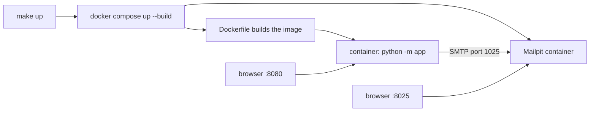
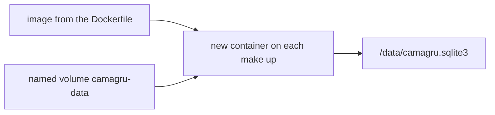
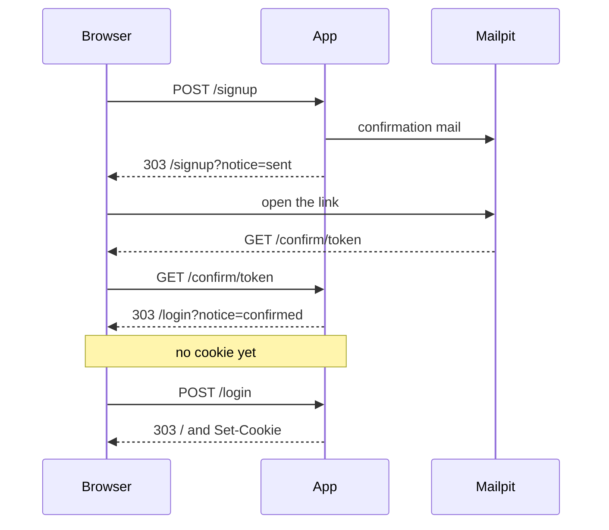

# 01 Accounts

Walkthrough for accounts: signup, confirmation, login, reset, and profile. The screen contract is [DESIGN.md](DESIGN.md), the decisions are the ADRs under [adr/](adr/), and the modules are walked line by line in [code/](code/01-main.md). The numbered clicks are in [section 9](#9-steps).

## 1. What starts the site

`make up` is `docker compose up --build -d`.

`--build` rebuilds the image from the [Dockerfile](../Dockerfile), because without it Compose reuses the previous image and the browser keeps showing the old pages. `-d` runs the containers in the background, so `make logs` is how you follow the output and `make down` is how you stop them. Ctrl+C only stops the site when `make up` was left in the foreground.

`make e2e-stop` kills `e2e/serve.py` when a test server is left over from `make e2e`. Its stand-in mail server holds ports 8026 and 2525, which do not clash with Mailpit, so it is only cleanup. It is the test server, not the one `make up` starts.

The Dockerfile runs at build time, before any process starts, and its `CMD ["python", "-m", "app"]` is the start command. `-m app` means "run the app package": [app/__init__.py](../app/__init__.py) makes the folder a package, and Python runs [app/__main__.py](../app/__main__.py) as the entry. That file refuses to listen when `CAMAGRU_SECRET` is empty, and otherwise serves HTTP.

Compose sets `CAMAGRU_PORT` to `8080`, and the left side of `"8080:8080"` is the port on your machine. The Dockerfile's `EXPOSE 8080` only documents that port; the Compose `ports` line is what publishes it.

`CAMAGRU_SECRET` signs the login cookie. `CAMAGRU_BASE_URL` is the origin written into mail links, and the only host the app agrees to serve. For `make up` only the secret has to be in `.env`, which Compose reads. The repo has no default secret, because a committed secret would let anyone sign a login cookie. When `.env` leaves the base URL empty, [compose.yml](../compose.yml) defaults it to `http://localhost:8080`.

There are three ways to run the app, each with its own defaults. `make up` serves port 8080 on `localhost`, set in Compose. A bare `python -m app` uses the defaults in the code: port 8765, every interface, and `http://127.0.0.1:8765` as the base URL. The end-to-end server uses the same port and base URL but binds only `127.0.0.1`. Mail always goes over SMTP. Inside Compose it goes to host `mailpit` on port 1025. Outside it goes to `127.0.0.1`: on port 1025 for a bare run, and on port 2525 for the end-to-end server, whose stand-in mail server listens there and shows its inbox on port 8026. Those two ports differ from Mailpit's, so `make e2e` runs while `make up` is up.

## 2. Where the database is

`camagru-data` is a Docker named volume, not a folder in the repo, and the file inside the container is `/data/camagru.sqlite3`.

`make up` rebuilds the image and starts a new container, but attaches the same volume again. That is why a rebuild still has yesterday's users: the image is new, and the database file was never inside the image. `make down` keeps the volume, while `make fclean` deletes it, so the next start has an empty database.

`make db` is `docker compose exec`: it runs Python inside the app container that is already running, opens that file, and prints `username | hash`. The hash is not the password.

A deployed site uses the same `DATABASE_PATH`, so point it at a disk that outlives the container, or mount a host directory on `/data`. `data/` is gitignored, so a local database there is never committed. `make up` uses the named volume so nobody has to create a folder first.

https://docs.docker.com/engine/storage/volumes/

## 3. Mailpit

The app sends mail with `smtplib` to host `mailpit` on port `1025`, which is SMTP. Port `8025` is the web page where you read the message; there are two ports because there are two protocols. The app never imports Mailpit.

Open http://127.0.0.1:8025 while `make up` is running.

## 4. One host only

`localhost` and `127.0.0.1` are different sites. A cookie set on one is not sent to the other, and the stylesheet is cached per site too, which is why one address can look unstyled while the other looks right.

Mail links use `CAMAGRU_BASE_URL`, so if the open tab is on the other host, the link and the tab do not share a session. To avoid that, the app redirects any other host to the base URL. Locally the base URL is `http://localhost:8080`, including in the mail links, so open both the site and Mailpit as localhost; `127.0.0.1` is redirected there.

## 5. Signup, confirm, login

A successful signup answers `303`, not `200`, because a `200` after a form post makes the browser submit the form again on refresh. Going back to the signup tab and refreshing would then post the same fields a second time and report the username as taken.

The confirmation link does not log you in. It marks the account confirmed and shows the login form, without setting a cookie.

Every failed login and every failed signup also redirects to a plain address, so a refresh reloads that page and never sends the password again. Without that, a tab left on a failed login would replay the post on refresh, and once the account was confirmed the replay would succeed, so the old tab would look logged in without anyone typing into it. A password failure lists only the checks that failed: shorter than 8, longer than 128, no letter, or no digit. `Passwordzz` fails only the digit check. A taken username or email is reported alongside those lines, not instead of them, and the message does not say which of the two is taken.

The quote password `blahblah' OR 1='1` reaches the hash check as a plain value. The SQL text stays `where lower(username) = lower(?)`, so the quote never becomes part of the statement and cannot make the condition true.

Login says which of its three failures happened: no such username, wrong password, or the confirmation link has not been opened yet. Asking for a reset does not change the current password; the old password only stops working once the new one is saved from the mail link.

Logout increments `session_version` and clears the cookie. When a session exists the header shows the username; when it does not, the header stays empty rather than saying "logged out".

## 6. Logs

Keep the browser console and the server log open while you use the site. Every log, warning, or error counts as a crash, with one exception: a `getUserMedia` warning. That warning means the browser blocked the camera because the page is not a secure origin. `localhost` counts as secure even over `http`, so the warning does not appear under `make up`; it appears on plain HTTP to a real host. The detail is in [13-editor-page.md](code/13-editor-page.md).

An access line is a log too, and the default Python server writes one per request, so [app/__main__.py](../app/__main__.py) turns that off. An exception becomes a short 500 page and is not printed either. `make logs` should stay empty apart from Mailpit starting. That is stricter than ordinary practice, but any log line during the defense counts as an error.

## 7. Old browsers

Printed page 5 names Firefox 41 and Chrome 46 so the site does not depend on a CSS or JavaScript feature those versions lack. The numbers are a floor, not an install list: the defense uses the browsers on the machine, and versions can be checked there. Firefox 41 does not run on a current Mac, Playwright launches the current browsers it installed, and a hosted farm such as BrowserStack is out of scope. So the practical check is current Firefox, current Chrome, the device toolbar at 360px, and https://caniuse.com/flexbox-gap for any new CSS. Flexbox `gap` is newer than both named versions, which is why this CSS uses margins.

The editor page script uses `var` and `function`, and `make lint` rejects CSS grid, flex `gap`, `aspect-ratio`, and `inset`.

| Used | At the floor | Link |
| --- | --- | --- |
| `getUserMedia` promise form | Firefox 41 has it. Chrome 46 does not, so the code calls `webkitGetUserMedia`. | [caniuse stream](https://caniuse.com/stream) |
| `video.srcObject` | Chrome 46 does not have it, so the code uses `createObjectURL` there. Firefox 41 does. | [caniuse srcObject](https://caniuse.com/mdn-api_htmlmediaelement_srcobject) |
| `FileReader.readAsDataURL`, canvas, `toDataURL` | Both. | [FileReader](https://developer.mozilla.org/en-US/docs/Web/API/FileReader/readAsDataURL) |
| `object-fit`, flexbox | Both. | [object-fit](https://caniuse.com/object-fit) |
| `playsinline` on the video | Ignored by both. A phone uses it. | [video](https://developer.mozilla.org/en-US/docs/Web/HTML/Element/video) |

The header stays on one line. The link for the page you are on is left out, Gallery and Editor included. A long username is cut with an ellipsis, and hovering it shows the full text. There are no emoji icons, because old Firefox draws them inconsistently.

## 8. Pillow

Accounts never call Pillow. The editor uses it to blend a PNG, because the subject requires a server-side composite and Python's standard library cannot do one, where PHP has GD. The mapping is [adr/images/0001](adr/images/0001-pillow-for-compositing.md).

## 9. Steps

`cd e2e && npm run walkthrough` runs steps 4 to 12, 14, and 15 with Playwright and fails on any console line. Steps 1, 2, 3, and 13 stay manual, because they read the checkout, start the containers, and open the database.

The clicks, in order. Leave the browser console and `make logs` open from step 3 on; any log other than a `getUserMedia` warning is a crash, and none of these steps asks for the camera. Open the site as the host in `CAMAGRU_BASE_URL`, which locally is <http://localhost:8080>, since `127.0.0.1` is a different site.

1. `git status -sb` and `git remote -v`. Pass: this checkout is the camagru repo you mean to run.
2. Put `CAMAGRU_SECRET` in `.env` and do not commit it. The base URL defaults to `http://localhost:8080`. Run `make up`. Pass: <http://localhost:8080> loads, <http://localhost:8025> is Mailpit, and `make logs` shows no request line.
3. Open the browser console and leave it open. Pass: no error and no warning.
4. Sign up as `ada`, `ada@example.com`, password `password`. Pass: the page says `Invalid password.` and lists `one digit`. Sign up is not in the navigation on this page, and the header does not say logged out.
5. Sign up again with `Password1`. Pass: you stay logged out, the page says to check the mail, and a refresh does not submit the form again. Mailpit has one message, subject `Confirm your camagru account`, thanking `ada`, with one `/confirm/` link.
6. Log in as `ada` / `Password1` before opening that link. Pass: the page says to open the confirmation link, the header stays empty, and a refresh does not send the password again.
7. Open the confirmation link. Pass: it shows the login form and does not log you in. Log in with `Password1`. Pass: the header shows `ada`.
8. Log out and open `/editor`. Pass: the address is `/login`. The logged-in editor is walked in [01-editor.md](01-editor.md).
9. Open `/reset`. Pass: an email field and Send link, with no password field, and the sentence says the new password is chosen on the link.
10. Send a reset for `ada@example.com`, open the `/reset/` link in Mailpit, set `Password2`, and log in with `Password2`. Pass: the header shows `ada`. Log out and try `Password1`. Pass: the page says that password does not match.
11. This one goes past the required checks. Send another reset and do not open the link. Pass: `Password2` still logs in, because asking for a reset does not change the current password.
12. While logged in, open `/profile` and change the username, the email, and the password. Pass: the page says `Profile saved.` Log out and log in with the new username and password. Pass: the header shows the new username. Save again with the password left blank. Pass: the current password still works.
13. `make db`. Pass: the value after `|` is not the password you typed; it looks like `hex$hex`.
14. Log out, then log in with the current username and password `blahblah' OR 1='1`. Pass: you stay logged out, and the page says that password does not match.
15. Narrow the window to about 360px and walk signup, login, reset, and profile. Pass: header, main, and footer are present, nothing overlaps, and a long username is cut with an ellipsis that shows the full text on hover. The link for the page you are on is left out.
