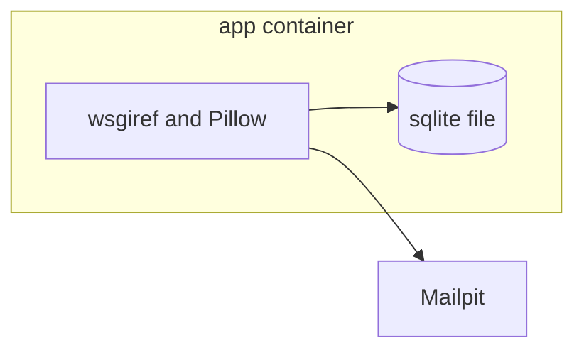

# ADR 0001: One app container and Mailpit
Date: 2026-10-21

## Status

Accepted

## Context

Printed page 9 requires one or more containers and one command. The site that `make up` starts must include the sqlite file ([stack/0001](../stack/0001-python-and-sqlite3.md)), and whoever runs it also has to read the confirmation mail. A second database container would add a service the subject does not name. Jinja is a template library with no PHP standard-library twin, while Python's `wsgiref` is standard library and can be the HTTP server. The subject allows Nginx, but the first version does not need it.

## Decision

I will run one application container holding `wsgiref`, the Python app, Pillow, and the sqlite file, with Mailpit as a second container that is only a mailbox. `make up` runs `docker compose up --build -d`, with `DOCKER ?= docker`. HTML is files plus escaping, not a template package, and Playwright stays out of the image. Layout:

- `app/` for the Python modules
- `public/` for the HTML pages and their scripts, CSS, and overlays
- `tests/` for `unittest`
- `e2e/` for the Playwright suite

## Consequences

Mail is read at the Mailpit URL named in the README, and the app never imports Mailpit. A failed `make up` on a clean clone fails the defense. The server uses `socketserver.ThreadingMixIn` so one idle connection does not stall the site, and it overrides `log_message` so a request line never reaches stderr, because the default `wsgiref` log would fail the defense. See Annex A.

## Annex

### Annex A - what `make up` starts

One command starts both. The database file stays with the app container, on the `camagru-data` volume mounted at `/data`, so a rebuild keeps it.
