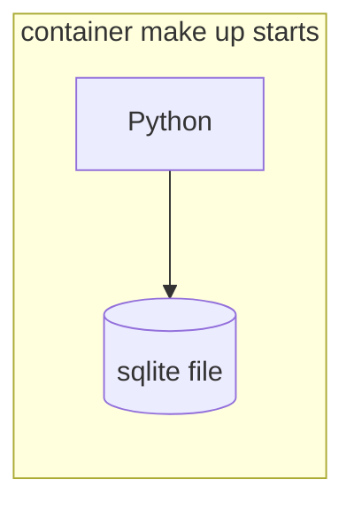

# ADR 0001: Python and sqlite3

Date: 2026-10-21

## Status

Accepted. The basedpyright sentence in Decision is superseded by [0002](0002-typed-boundaries.md).

## Context

v4.1 allows any server language as long as every function has a PHP standard-library equivalent, and it names no database engine. The deadline is days away, which leaves no room for a PHP course. Flask, Django, an ORM, and Sinatra are frameworks without a PHP standard-library twin, and Ruby would need a database gem. Python's `sqlite3` is in the standard library, and [PDO_SQLITE](https://www.php.net/manual/en/ref.pdo-sqlite.php) is its PHP equivalent.
## Decision

We will use Python 3.15.0 and `sqlite3`. 3.15.0 is the only version this repo names, and uv installs that exact build. python.org published a 3.15.1 tarball on 21 Oct 2026, but uv has no 3.15.1 download, so the repo does not name 3.15.1, and a different version reopens this ADR. Queries will use placeholders, the README maps each call to PDO_SQLITE, and there will be no ORM. The database file will live in the container that `make up` starts.

uv installs the interpreter and Pillow, and application code does not import it. Lint is ruff, run through `uvx`; unit tests are `unittest`; the build is `compileall`, then basedpyright, with the typecheck rules in [stack/0002](0002-typed-boundaries.md). Browser tests are Playwright in `e2e/`. The app imports none of these tools.

## Consequences

There is no database package to defend. SQL errors raise by default, which is the behavior of PDO's exception error mode. uv is a build tool in the same class as Make, not a library the subject has to map. A different version, including 3.15.1 once uv can install it, reopens this pin. Images are [images/0001](../images/0001-pillow-for-compositing.md), mail is [mail/0001](../mail/0001-mail-through-smtplib.md), login state is [auth/0001](../auth/0001-signed-session-cookie.md), and the container is [deploy/0001](../deploy/0001-one-app-container-and-mailpit.md). See Annex A.

## Annex

### Annex A - where the database file lives

The sqlite file sits with that container, on its `/data` volume, not on a second database service.
