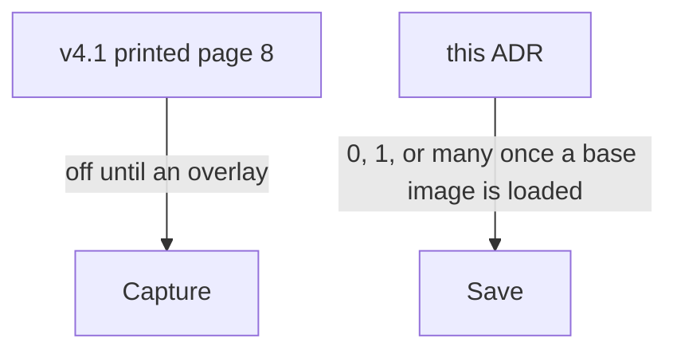

# ADR 0001: Build to v4.1
Date: 2026-10-20

## Status

Accepted

## Context

Camagru must be ready to defend by 26 Oct 2026. The PDF from the 30 Jun 2023 registration and the PDF after the 20 Oct 2026 resubscribe are the same file, sha256 `75a577eb9b7709f1a90eceea2549d0915cdcf3b589f56963333dad7b507a5eb3`, version 4.1, and the API returns no subject attachment. This is the 42S-3 decision, recorded in the repo on 21 Oct 2026, when the repo first had files.

Printed page 8 keeps capture inactive until an overlay is selected. A base image can also come from an upload, and the page does not say that saving it needs an overlay.

## Decision

I will build to v4.1. Capture waits for an overlay, and Save accepts 0, 1, or many overlays once a base image is loaded.

## Consequences

There is one subject file to defend. Save does not wait for an overlay, and the defense states that reading of printed page 8. A later resubscribe that hashes differently reopens this ADR. See Annex A.

## Annex

### Annex A - what waits for an overlay

Capture follows the PDF as printed, and Save accepts any number of overlays on a loaded base image.
