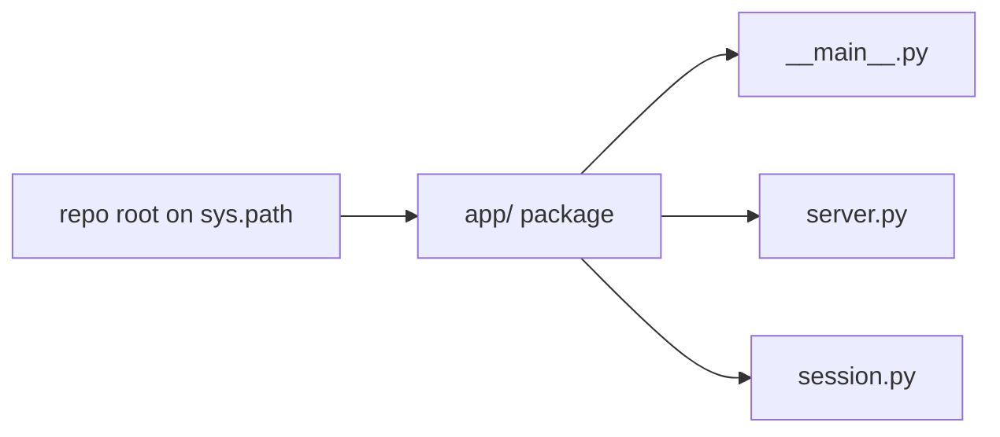
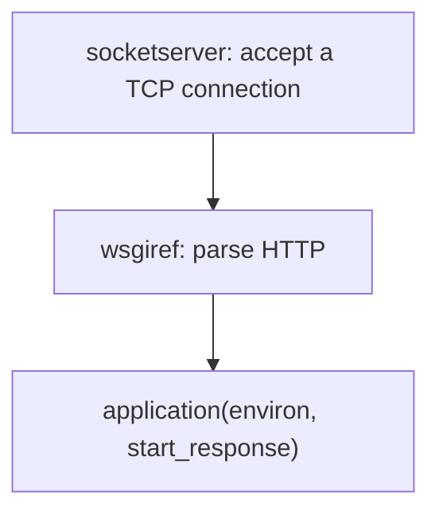

# 01 main

Line by line for [app/__main__.py](../../app/__main__.py). The walkthrough is in [accounts.md](../accounts.md).

## Where `app` comes from

`app` is not built into Python: it is the directory `app/`, which `__init__.py` makes a package. Rename the folder to `backend` and the imports become `backend.server`, and the command becomes `python -m backend`.



`python -m app` puts the current directory on the import path and runs `app/__main__.py`. Inside the container the current directory is `/app`, the Dockerfile's `WORKDIR`, and the package is the inner folder `/app/app/`.

```python
from app.server import application
from app.session import server_listens
```

https://docs.python.org/3/tutorial/modules.html#packages
https://docs.python.org/3/using/cmdline.html#cmdoption-m

## Two servers



`socketserver` accepts TCP connections, and `wsgiref` parses HTTP and calls the app. WSGI (PEP 3333) is the shape of that call, which is why the same `application` function runs under this server and under the tests, which open no port of their own.

```python
class ThreadingServer(socketserver.ThreadingMixIn, WSGIServer):
    daemon_threads: bool = True
```

Without the mixin, one connection is finished before the next starts, so a browser that keeps a connection open would stall every other visitor. `daemon_threads` lets those threads die when the process exits.

```python
class QuietHandler(WSGIRequestHandler):
    def log_message(self, format: str, *args: object) -> None:
        # The default prints one stderr line per request. Any log line during the defense counts as an error.
        return
```

The default handler prints one stderr line per request, and any log line during the defense counts as an error, so this method returns immediately.

https://docs.python.org/3/library/socketserver.html#socketserver.ThreadingMixIn
https://docs.python.org/3/library/wsgiref.html#wsgiref.simple_server.WSGIRequestHandler
https://peps.python.org/pep-3333/

## Listen

```python
def main() -> None:
    secret = os.environ.get("CAMAGRU_SECRET", "")

    if not server_listens(secret):
        raise SystemExit(1)

    host = os.environ.get("CAMAGRU_BIND", "0.0.0.0")
    port = int(os.environ.get("CAMAGRU_PORT", "8765"))
    server = ThreadingServer((host, port), QuietHandler)
    server.set_app(application)

    try:
        server.serve_forever()
    except KeyboardInterrupt:
        return
```

An empty secret exits before the port opens; why that matters for the cookie is in [02-server.md](02-server.md). `0.0.0.0` is every interface, which a container needs. Port `8765` is the default outside Docker, and Compose sets `8080`. `set_app` is the handoff that sends every request to `server.application`. `serve_forever` blocks until Ctrl+C, and the `except` turns that interrupt into a plain return, so stopping the server prints no traceback.

https://docs.python.org/3/library/os.html#os.environ
https://docs.python.org/3/library/exceptions.html#SystemExit
https://docs.python.org/3/library/exceptions.html#KeyboardInterrupt
