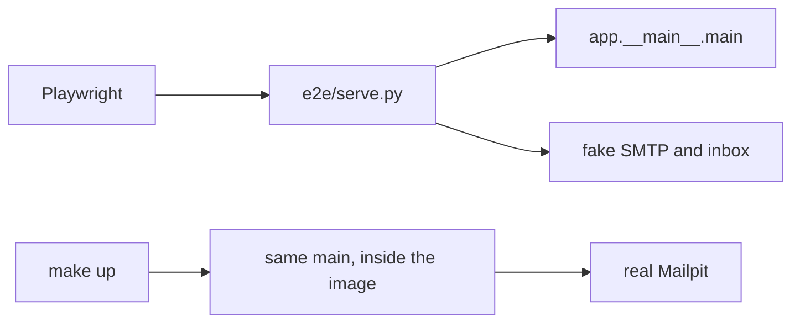

# 02 server

Line by line for [app/server.py](../../app/server.py). The account steps live in [01-accounts.md](../01-accounts.md), and the cookie itself is built in [03-session.md](03-session.md). How the cookie answers the subject is the short section [The cookie, one sentence](#the-cookie-one-sentence) below.

## End-to-end runner

[e2e/serve.py](../../e2e/serve.py) is not a second app. It calls the same `main` as `make up`, but with its own database and a fake mailbox instead of the ones `make up` uses.

```python
os.environ.setdefault("CAMAGRU_SMTP_PORT", "2525")
os.environ.setdefault("CAMAGRU_BIND", "127.0.0.1")
os.environ.setdefault("CAMAGRU_PORT", "8765")
os.environ.setdefault("DATABASE_PATH", os.path.join(ROOT, "data", "e2e.sqlite3"))
...
smtp = socketserver.ThreadingTCPServer(("127.0.0.1", 2525), SmtpHandler)
http = socketserver.ThreadingTCPServer(("127.0.0.1", 8026), MailHttp)
...
from app.__main__ import main as serve_app

serve_app()
```

`SmtpHandler` and `MailHttp` live in that file because they share one message list, and keeping them together avoids passing that list across modules.



Three differences from `make up`:

- It listens on port 8765 with base URL `http://127.0.0.1:8765`, while `make up` is `localhost:8080`.
- `data/e2e.sqlite3` is deleted at the start, whereas the Docker volume keeps its users.
- Mail goes to the fake server, with SMTP on port 2525 and the inbox on 8026, instead of Mailpit on 1025 and 8025. The ports differ so `make e2e` can run while `make up` is still up, and the fake inbox speaks just the part of Mailpit's API that Playwright reads.

## `application`

`__main__` registers this function with `set_app`. `environ` is the request, `start_response` sends the status line, and the return value is the body as a list of bytes.

```python
def application(environ: WSGIEnvironment, start_response: StartResponse) -> list[bytes]:
    secret = os.environ.get("CAMAGRU_SECRET", "")

    try:
        status, headers, body = handle(environ, secret)
    except sqlite3.OperationalError:
        status = "500 Internal Server Error"
        headers = [("Content-Type", "text/html; charset=utf-8")]
        body = b"database is locked"
    except Exception as exc:
        status = "500 Internal Server Error"
        headers = [("Content-Type", "text/html; charset=utf-8")]
        detail = ""

        if os.environ.get("CAMAGRU_DEBUG"):
            detail = " " + escape(type(exc).__name__)

        body = f"something went wrong{detail}".encode()

    start_response(status, headers)

    return [body]
```

`sqlite3.OperationalError` means the database file is busy. Any other exception becomes a short page and nothing is printed. When `CAMAGRU_DEBUG` is set, the page also names the exception class, escaped; the end-to-end runner sets it and `make up` does not.

`secret` is read once here and passed into `handle`. Every signature in that request uses the same string. A test calls `handle` with a known key and does not set the environment first. Reading `os.environ` when the file is imported would freeze the value from that moment, which is too early for those tests. A function that does not receive the key cannot build a cookie or a CSRF token.

https://peps.python.org/pep-3333/#the-application-framework-side
https://docs.python.org/3/library/sqlite3.html#sqlite3.OperationalError

## `handle`

The controller: it picks a function for the request and leaves the HTML to `pages.py`.

```python
canonical = _canonical(environ)

if canonical is not None:
    return canonical

path = env_str(environ, "PATH_INFO", "/") or "/"
method = env_str(environ, "REQUEST_METHOD", "GET").upper()
query = parsed_query(environ)
static = _static(path)

if static is not None:
    return static

conn = connect()

try:
    user = _user(conn, environ, secret)
    form = parsed_body(environ) if method == "POST" else {}
    ...
finally:
    conn.close()
```

`PATH_INFO` is the path and `REQUEST_METHOD` is `GET` or `POST`. https://peps.python.org/pep-3333/#environ-variables

1. `_canonical` sends any other host to `CAMAGRU_BASE_URL` before a page runs. The concrete case is in [10-helpers.md](10-helpers.md).
2. `_static` serves the files listed in `STATIC` straight from `public/`: the stylesheet `/app.css`, the raw `/shell.html` template, the sample photo, and the two frames. Filled pages are built in `pages.py`.
3. `finally` closes sqlite even when a route returns on its first line. https://docs.python.org/3/reference/compound_stmts.html#finally
4. `_user` reads the cookie and returns the user row, or `None`.
5. A `POST` body becomes a dict, and a `GET` has no form.
6. The path picks `_signup`, `_login`, `_logout`, `_reset`, `_profile`, `_confirm`, `_editor`, or `_picture`. When `CAMAGRU_E2E` is set, `POST /e2e/reset` also empties the gallery for Playwright.
7. `/editor` with no user redirects to `/login`. The nav link is already hidden, but the address can still be typed, so it has to redirect.
8. Anything else is the gallery, `_gallery`.

## The cookie, one sentence

The subject does not say "use an HMAC cookie". Printed page 6 says a plain password is not secure and that an outside form must not change private data.

The cookie holds the user id, a version, an expiry, and a signature, while the password stays in the database as a hash. Forging that signature is the attack that has to fail, which is why the server refuses to listen with an empty secret. The outside-form rule is the CSRF token. Both are built in [03-session.md](03-session.md).

## `_signup`

Creates an unconfirmed user and mails one link. Every result is a redirect, so a refresh does not send the form again.

```python
def _signup(conn: sqlite3.Connection, method: str, form: SignupForm, query: SignupQuery) -> Response:
    notice = query["notice"]
    username = form["username"] or query["username"]
    email = form["email"] or query["email"]
    password = form["password"]

    if method != "POST":
        text = _notice(notice) if notice == "sent" else ""

        return _html(signup_page(username, email, _phrases(notice), text))

    codes = _signup_codes(conn, username, email, password)

    if codes:
        return _redirect(_signup_target(codes, username, email))

    user_id = insert_user(conn, username, email, password)

    if user_id is None:
        return _redirect(_signup_target(["taken"], username, email))

    token = issue_token(conn, user_id, "confirm")
    link = _base() + "/confirm/" + token
    _send(email, confirmation(username, email, link))

    return _redirect("/signup?notice=sent")
```

A `GET` shows the form. `notice=sent` shows the sentence after a successful signup, and any other notice code (`taken`, `digit`, `short`, ...) becomes red text listing only the password rules that failed.

A `POST` collects failure codes first. A taken name or email is reported even when the password is also bad, and the password lines are only the rules it failed. `Passwordzz`, for example, is long enough and has a letter, so the only line under `Invalid password.` is `one digit`.

```python
codes: list[str] = []

if not _username_ok(username):
    codes.append("baduser")

if not _email_ok(email):
    codes.append("bademail")

names_ok = "baduser" not in codes and "bademail" not in codes

if names_ok and (username_taken(conn, username) or email_taken(conn, email)):
    codes.append("taken")

return codes + password_codes(password)
```

The redirect puts those codes in the query string, along with the username and email so the fields stay filled. The password never goes in the URL.

```python
return (
    "/signup?notice="
    + ",".join(codes)
    + "&username="
    + quote(username)
    + "&email="
    + quote(email)
)
```

`quote` percent-encodes the values so an email stays one query field. https://docs.python.org/3/library/urllib.parse.html#urllib.parse.quote

When there are no codes, `insert_user` writes the row. It returns `None` when the unique index rejects a name or email taken by a race the check did not see. The plain token goes only into the mail, because the database stores its hash (`issue_token`, walked in [05-store.md](05-store.md)), and `_send` delivers the mail over SMTP. https://docs.python.org/3/library/smtplib.html

The browser then lands on `GET /signup?notice=sent`, so refreshing that address does not create a second account.

## `_login`

Sets the cookie only when the username exists, the password matches, and the account is confirmed. A failure is a redirect, so a refresh cannot replay the password.

```python
def _login(
    conn: sqlite3.Connection,
    secret: str,
    method: str,
    form: LoginForm,
    user: SessionUser | None,
    query: LoginQuery,
) -> Response:
    notice = query["notice"]
    username = query["username"]

    if method != "POST":
        return _html(login_page(user, username, _login_error(notice), _notice(notice)))

    username = form["username"]
    password = form["password"]
    found = find_user(conn, username)
    target = "/login?username=" + quote(username)

    if found is None:
        return _redirect(target + "&notice=unknown")

    if not password_matches(found, password):
        return _redirect(target + "&notice=badpw")

    if not found["confirmed"]:
        return _redirect(target + "&notice=unconfirmed")

    return _redirect("/", _cookie(found, secret))
```

A `GET` paints the form, with the username and a notice code from the last attempt carried in the query string; the password is never in that URL. The three failure sentences are:

```python
{
    "unknown": "No account uses that username.",
    "badpw": "That password does not match.",
    "unconfirmed": "Open the confirmation link in the mail for this account before logging in.",
}
```

The checks run in that order. A wrong password stops before the confirmation check, so a guess does not learn whether the account is confirmed, while a right password on an unconfirmed account is told to open the mail, which is what that person needs.

`find_user` matches the username regardless of case, and `password_matches` hashes what was typed and compares it to the stored hash. The quote in `blahblah' OR 1='1` is just characters in that hash input and is never spliced into SQL; the SQL walk is [05-store.md](05-store.md).

Success is the only branch that calls `_cookie`. The redirect to `/` carries one `Set-Cookie` header. `HttpOnly`, `SameSite`, `Path`, and `Max-Age` are attributes of that header, not extra headers. The browser stores it and sends it on the next request.

`camagru` is the cookie name. The value after `=` is the user id, version, expiry, and signature. `HttpOnly` keeps page scripts from reading it. `SameSite=Lax` sends it on a normal click from another site, and not on a form post from another site. `Path=/` is why the browser attaches it to every path on this host. `Max-Age=43200` drops it after 12 hours. `Secure` is added only when `CAMAGRU_BASE_URL` starts with `https`, so it is off under `make up`, which serves plain `http`.

```python
value = issue_cookie(user["id"], user["session_version"], secret, int(time.time()))
base = os.environ.get("CAMAGRU_BASE_URL", "")
secure = "; Secure" if base.startswith("https") else ""
header = f"camagru={value}; HttpOnly; SameSite=Lax; Path=/; Max-Age=43200{secure}"

return ("Set-Cookie", header)
```

`issue_cookie` builds the user id, version, expiry, and signature, and is walked in [03-session.md](03-session.md). `time.time` is the unix time used as "now". https://docs.python.org/3/library/time.html#time.time https://developer.mozilla.org/en-US/docs/Web/HTTP/Headers/Set-Cookie

The redirect also closes a confirm-link trap. If a failed login answered `200`, the address bar would still hold the `POST`, and a refresh would send the username and password again; had the other tab just opened the confirmation link, that replay would log in. The `303` turns the address bar into a `GET`, so a refresh reloads the page without the password.

## `session_version`

An integer column on the user row that starts at 1. The cookie carries a copy, and a request counts as logged in only when that copy equals the column.

```python
def end_session(conn: sqlite3.Connection, user_id: int) -> None:
    conn.execute(
        "update users set session_version = session_version + 1 where id = ?",
        (user_id,),
    )
    conn.commit()
```

Logout calls this, so the column becomes 2 while an old cookie still says 1. The signature is still valid, but the version check rejects it. A password change and a finished reset do the same bump.

There is no table of issued cookies, because the cookie is the session. A copied cookie cannot be deleted from someone else's disk, but the row can change: the copy keeps a good signature, since the server signed it when it issued it, and fails the version check because the row has moved on.

## The password on the wire

DevTools shows `password=password1` because it is the browser, looking at the form body before TLS would hide it. `make up` serves `http://localhost`, so there is no TLS and the payload tab shows the bytes.

The server has to receive the password, because it hashes the typed password and compares that to the stored hash; checking a password the server never sees would need a protocol this subject does not ask for. The rule is narrower: it is not stored in the clear, not put in the cookie, and not written to a log. The form body is the only place it exists, and only for that request.

## Salt, briefly

`hash_password` makes a new random salt for every password and stores `salt$hash`, with `$` separating the two hex strings. Because the salt differs, the same password stored twice looks different. A login check splits on `$`, re-hashes with the stored salt, and compares. The line-by-line is [04-passwords.md](04-passwords.md).

## `_logout`

Ends the session on the server, then tells the browser to drop the cookie. Clearing the cookie alone would leave any copy someone already saved still valid, because the version on the row would not have moved.

```python
def _logout(
    conn: sqlite3.Connection,
    user: SessionUser | None,
    csrf: str,
    secret: str,
) -> Response:
    if user is None or not csrf_accepts(csrf, user["id"], user["session_version"], secret):
        return _html(login_page(user))

    end_session(conn, user["id"])

    return _redirect("/login", ("Set-Cookie", "camagru=; HttpOnly; SameSite=Lax; Path=/; Max-Age=0"))
```

`handle` passes in `csrf_form(form)["csrf"]`, the hidden field from the logout form.

## CSRF

Printed page 6 says an outside form must not change private data, and CSRF is that attack. The member is logged in, and another site serves a form whose action is `http://localhost:8080/logout` and submits it. A browser that ignores `SameSite` would send that cookie with that post, and Firefox 41 and Chrome 46 are such browsers, so `SameSite=Lax` is not a protection the app can rely on.

Every member form therefore carries a hidden field whose value is the HMAC of the user id and `session_version`, keyed by `CAMAGRU_SECRET`, and `csrf_accepts` recomputes it and compares. The other site can make the browser send the cookie, but it cannot invent the field without the secret. The same check guards logout, the profile save, the editor save, delete, like, and comment. Signup, login, and the reset request have no session, so there is no cookie for another site to ride. The comparison is in `session.py`.

https://developer.mozilla.org/en-US/docs/Glossary/CSRF

A logout post without the field neither calls `end_session` nor clears the cookie, so the next request with the same cookie is still logged in. The suite uses that as its stand-in for the outside form, and a real page on another site fails the same check.

## Clearing the cookie

`camagru=` replaces the stored value with an empty string but does not delete the cookie: without an expiry the browser keeps the empty cookie for the rest of the session, and a copy saved earlier is untouched. `Max-Age=0` is what deletes it, and it must use the same name and `Path=/` as the cookie that was set. Since `end_session` has already moved the row, any copy the browser did not delete is still rejected.

https://developer.mozilla.org/en-US/docs/Web/HTTP/Headers/Set-Cookie#max-agenumber

## `_reset`

Two pages: `/reset` asks for the email and `/reset/<token>` sets the password. The token is the only proof the person read the mail. An empty email does not pretend a mail was sent, a weak password does not burn the token, and asking for a reset does not change the current password.

```python
notice = query["notice"]
token = path[len("/reset/") :] if path.startswith("/reset/") else form["token"]
email = form["email"] or query["email"]
action = path if token else "/reset"

if method != "POST":
    text = ""

    if notice == "sent":
        text = "If that email has an account, a reset link is on its way."

    return _html(reset_page(
        email,
        _phrases(notice),
        token,
        action,
        text,
    ))

if form["action"] == "request" and not token:
    email = email.strip()

    if not _email_ok(email):
        return _redirect("/reset?notice=bademail&email=" + quote(email))
    ...
    return _redirect("/reset?notice=sent&email=" + quote(email))

password = form["password"]

if not token:
    return _html(reset_page(email, "Open the link from the mail to choose a password."))

if not accept_password(password):
    return _redirect(action + "?notice=" + ",".join(password_codes(password)))

user_id = consume_token(conn, "reset", token)

if user_id is None:
    return _html(reset_page(email, "that reset link is not valid"))

set_password(conn, user_id, password)

return _redirect("/login?notice=reset")
```

A `GET` of `/reset` is the email form, and a `GET` of `/reset/<token>` is the new-password form because `token` came from the path. The email form has no password field.

`action=request` looks the user up by email. Known and unknown addresses both redirect to `notice=sent`, because the page must not say which addresses have accounts, but only a known address gets `issue_token` and a mail. The link is `/reset/` plus the plain token, and the database stores only its hash.

A new password posted without a token is refused; otherwise posting an email and a new password would reset the account without the mail. A weak password redirects back to the same token URL listing only the failed rules, and since `consume_token` has not run, the link still works. An expired or already used link gets "that reset link is not valid". A good password consumes the token once, stores the new hash, bumps `session_version`, and sends the browser to login, so the old password stops working here and not when the mail was requested.

## `_profile`

A logged-out visitor gets a sentence asking them to log in rather than a redirect. The editor address redirects, but the profile is just a form, so the sentence is enough.

A `GET` shows the current username and email, an empty password field, the comment-mail checkbox, and the CSRF field. `notice=saved` adds the blue "Profile saved." line after a successful post.

```python
def _profile(
    conn: sqlite3.Connection,
    secret: str,
    method: str,
    form: ProfileForm,
    user: SessionUser | None,
    notice: str = "",
) -> Response:
    if user is None:
        return _html(plain_page(None, "<p>Log in to edit your profile.</p>"))

    if method != "POST":
        return _html(profile_page(user, user["csrf"], notice=_notice(notice)))

    if not csrf_accepts(form["csrf"], user["id"], user["session_version"], secret):
        return _html(profile_page(user, user["csrf"], "the form was refused"))

    username = form["username"]
    email = form["email"]
    password = form["password"]
    error = _profile_error(conn, user, username, email, password)

    if error:
        return _html(profile_page(user, user["csrf"], error))

    mail_ok = form["mail_ok"] == "1"
    version = update_profile(conn, user, username, email, password, mail_ok)

    if version is None:
        return _html(profile_page(user, user["csrf"], "that username or email is taken"))

    updated = find_user_id(conn, user["id"])

    if updated is None:
        raise ValueError("profile")

    return _redirect("/profile?notice=saved", _cookie(updated, secret))
```

Without the CSRF field the post is refused with `the form was refused` and nothing is written, the same check as logout. The suite posts the profile form with the field set to `nope` and checks that the username did not change.

`_profile_error` runs before the write. A bad username or email is one sentence, and a password that was filled in but fails the rules becomes the `Invalid password.` list, while a blank password skips that check. The username and email are refused when another row already has them; the member's own row is allowed, so saving without changing the name is fine. If the row disappears mid-request, `find_user_id` returns `None` and the `ValueError` becomes the 500 page from `application`.

```python
def update_profile(
    conn: sqlite3.Connection,
    user: User,
    username: str,
    email: str,
    password: str,
    mail_ok: bool,
) -> int | None:
    version = user["session_version"]
    stored = user["password"]

    if password:
        stored = hash_password(password)
        version = version + 1

    try:
        conn.execute(
            """
            update users
            set username = ?, email = ?, password = ?, session_version = ?, mail_ok = ?
            where id = ?
            """,
            (username, email, stored, version, 1 if mail_ok else 0, user["id"]),
        )
        conn.commit()
    except sqlite3.IntegrityError:
        conn.rollback()

        return None

    return version
```

A blank password keeps the stored hash and leaves `session_version` alone, so other sessions stay logged in. A new password stores a new hash and bumps the version, which logs out every other cookie, and the redirect sends this browser a new cookie built with the new version so this tab stays logged in. `None` from `update_profile` means the unique index caught a race the earlier check did not see, so the page says the name or email is taken and the row is unchanged.

The version is the revocation stamp, and there is only one per user, so bumping it logs out every cookie, including a phone left signed in. A new password is the moment those other sessions should die, because they logged in with the secret that was just replaced. A new username or email does not replace that secret, and the cookie identifies the user id rather than the spelling of the name, so those sessions are still the same person and a rename does not kick them out.

The walkthrough step changes the username, email, and password, logs out, and logs in with the new ones. The same form has the comment-mail checkbox, which stores `mail_ok` as 1 when ticked and 0 when not, and the gallery reads that flag before it sends a comment letter.

## `_confirm`

The link in the signup mail. It does not log the account in: it marks the row confirmed and sends the browser to the login form.

```python
def _confirm(conn: sqlite3.Connection, path: str) -> Response:
    token = path[len("/confirm/") :]
    user_id = consume_token(conn, "confirm", token)

    if user_id is None:
        return _html(login_page(None))

    confirm_user(conn, user_id)

    return _redirect("/login?notice=confirmed")
```

`consume_token` hashes the path token and looks for an unexpired row with that hash and kind `confirm`. It deletes only that row, not every token the user has, so a second click or a guess finds nothing and gets the login form with no green sentence and no cookie. `_reset` uses the same function with kind `reset`, and those are the only two kinds. `issue_token` also deletes the previous token of the same kind before saving a new one, so at most one confirm link and one reset link are live. Both functions are walked in [05-store.md](05-store.md).

`confirm_user` sets `confirmed = 1` without touching the password or `session_version`, since there is no session yet. The redirect's notice is the sentence "Account confirmed. Log in with your username and password."

Until that flag is 1, `_login` returns `notice=unconfirmed` and sets no cookie, which is the subject rule that the account cannot be used before the unique link is opened.
