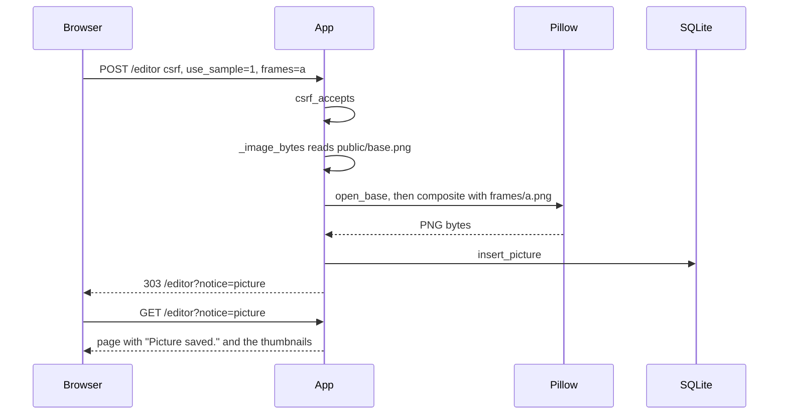

# 11 Editor routes

The editor handlers in [app/server.py](../../app/server.py): `_editor`, `_picture`, `_save_picture`, `_frame_bytes`, and `_image_bytes`. The editor walkthrough is [01-editor.md](../01-editor.md), the blend is [12-compose.md](12-compose.md), and the front door that calls these is [02-server.md](02-server.md).

## One save, end to end



The browser sends sticker names and a photo, never a finished picture. The server builds the picture itself, which is the server-side composite that printed page 8 asks for.

## The page and the save

```python
def _editor(
    conn: sqlite3.Connection,
    secret: str,
    method: str,
    form: EditorForm,
    user: SessionUser | None,
    query: EditorQuery,
    frames: list[str],
) -> Response:
    if user is None:
        return _redirect("/login")

    if method != "POST":
        error = _editor_error(query["error"])
        notice = _notice(query["notice"])

        return _html(
            editor_page(
                user,
                error,
                list_pictures(conn, user["id"]),
                notice,
            )
        )

    if not csrf_accepts(form["csrf"], user["id"], user["session_version"], secret):
        return _redirect("/editor?error=refused")

    if form["gif"] == "1":
        error = _store_gif(conn, user, form, frames)

        return _redirect("/editor?error=gif" if error else "/editor?notice=gif")

    code = _save_picture(conn, user, form["upload_b64"], form["use_sample"], frames)

    if code:
        return _redirect("/editor?error=" + code)

    return _redirect("/editor?notice=picture")
```

A visitor who is not logged in is sent to the login page.

A GET draws the page, and the words on it come from the address: `?error=nobase` becomes "Capture a photo, upload a PNG, or use the sample photo before saving." through `_editor_error`, and `?notice=picture` becomes "Picture saved." through `_notice`. A GIF save lands on `?notice=gif`, which gives "GIF saved." the same way. An unknown code maps to an empty string, so a typed address cannot inject text.

A POST never draws the page; every branch is a `303` to a GET address. That is what makes refresh safe, because the address bar then holds `/editor?notice=picture` and reloading it only reads.

The CSRF token is the same check as on the profile form, see [03-session.md](03-session.md). A form on another site cannot know the token, so it cannot save into the member's account.

`gif=1` comes from the Save GIF button and goes to `_store_gif`, which turns three snaps into one GIF; the button side of that flow is in [23-preview.md](23-preview.md). Every other save goes through `_save_picture`, which returns `""` on success or a short code that goes into the address.

## Reading the photo

```python
def _image_bytes(upload_b64: str, use_sample: str) -> bytes | None:
    payload = upload_b64

    if payload:
        if "," in payload:
            payload = payload.split(",", 1)[1]

        try:
            # https://docs.python.org/3/library/base64.html#base64.b64decode
            return base64.b64decode(payload, validate=True)
        except binascii.Error:
            # Bad base64 still reaches open_base, which refuses it as not an image.
            # https://docs.python.org/3/library/binascii.html#binascii.Error
            return b"not-an-image"

    if use_sample == "1":
        path = os.path.join(os.path.dirname(__file__), "..", "public", "base.png")

        with open(path, "rb") as handle:
            return handle.read()

    return None
```

A capture or an upload arrives as base64 text in `upload_b64`, and it wins over the sample. The sample photo arrives as `use_sample=1`, and the server reads its own copy of the file. `None` means the post had neither, which becomes `nobase`.

A data URL looks like `data:image/png;base64,iVBORw0...`, where the part before the comma is a label, so `split(",", 1)[1]` keeps only the encoded bytes. `validate=True` refuses characters that are not base64 instead of silently skipping them. A broken payload raises `binascii.Error`, and the function returns bytes that are not an image, so the next check refuses it with the same message as any other bad file.

Printed page 8 asks for an upload as an alternative to the webcam but does not prescribe base64 or forbid a multipart body. Posting the file as text is my choice, written down as AC-10 in [SPEC.md](../SPEC.md). The comments on those lines link `b64decode` and `binascii.Error`.

## Building and storing

```python
def _save_picture(
    conn: sqlite3.Connection,
    user: SessionUser,
    upload_b64: str,
    use_sample: str,
    frames: list[str],
) -> str:
    raw = _image_bytes(upload_b64, use_sample)

    if raw is None:
        return "nobase"

    try:
        open_base(raw)
    except ValueError:
        return "notimage"

    png = composite(raw, _frame_bytes(frames))
    insert_picture(conn, user["id"], png, time.time())

    return ""
```

`open_base` asks Pillow to decode the bytes. A `fake.png` containing `hello` fails there, and the page says the file is not an image, because what matters is the bytes, never the extension.

`frames` is a list because two ticked boxes post `frames=a&frames=b`. `handle` reads it with `allow_many(form, "frames")` in [app/boundary.py](../../app/boundary.py), which keeps every value for that one name, while every other field keeps only its last value.

In `_frame_bytes` the guard is `if name not in ("a", "b"): continue`. A post of `frames=../../app/server` fails that test, so the loop never builds a path from it: `open` runs only for `a` and `b`, and the path is always `public/frames/` plus that name plus `.png`.

The file is opened with `"rb"`, read bytes, because `"r"` would decode it as text and corrupt the PNG. The comment on that `open` links the modes.

The stored row is the composite PNG and the time. An empty `frames` list is still valid, which is the zero-sticker save.

## Delete and the image address

The like and comment branches at the top of `_picture` are covered in [17-gallery-routes.md](17-gallery-routes.md). This section is about delete and serving the image.

```python
def _picture(
    conn: sqlite3.Connection,
    secret: str,
    method: str,
    form: Parsed,
    user: SessionUser | None,
    path: str,
) -> Response:
    rest = path[len("/pictures/") :]

    if rest.endswith("/like") and method == "POST":
        return _like(conn, user, like_form(form), secret, rest[: -len("/like")])

    if rest.endswith("/comment") and method == "POST":
        return _comment(conn, user, comment_form(form), secret, rest[: -len("/comment")])

    if rest.endswith("/delete") and method == "POST":
        posted = csrf_form(form)

        if posted["xhr"] == "1":
            picture_id = rest[: -len("/delete")]
            deleted = (
                user is not None
                and picture_id.isdigit()
                and csrf_accepts(posted["csrf"], user["id"], user["session_version"], secret)
                and delete_picture(conn, int(picture_id), user["id"])
            )

            return _json({"ok": deleted})

        if user is None:
            return _redirect("/login")

        picture_id = rest[: -len("/delete")]
        token = posted["csrf"]
        deleted = (
            picture_id.isdigit()
            and csrf_accepts(token, user["id"], user["session_version"], secret)
            and delete_picture(conn, int(picture_id), user["id"])
        )

        if not deleted:
            return _redirect("/editor?error=notyours")

        return _redirect("/editor?notice=deleted")

    if rest.isdigit():
        row = picture_bytes(conn, int(rest))

        if row is None:
            return "404 Not Found", [("Content-Type", "text/plain; charset=utf-8")], b"missing"

        kind = "image/gif" if row["image_bytes"][:4] == b"GIF8" else "image/png"

        return "200 OK", [("Content-Type", kind)], row["image_bytes"]

    return _redirect("/editor")
```

The page script in `shell.html` submits the Delete form with `xhr=1` and removes the thumbnail in place when the JSON says `ok`; that path is [22-ajax.md](22-ajax.md). Without the script, the plain form post takes the second branch: `POST /pictures/7/delete` by the owner returns `303 /editor?notice=deleted`, while the same post by another member returns `303 /editor?error=notyours` and the row stays.

The button is a form, and an HTML form's method can only be `get` or `post`, so `DELETE` is not an option. [form method](https://developer.mozilla.org/en-US/docs/Web/HTML/Reference/Elements/form#method) The CSRF token has to ride in the body, because a `GET` would put it in the address, and an image tag on another site could fire that address. `POST` plus the token is the same protection logout uses.

The owner check is inside the SQL, `where id = ? and user_id = ?`, in `delete_picture` in [app/store.py](../../app/store.py), which returns true only when exactly one row went away. `and` stops at the first false value, so a bad id never reaches the database.

`GET /pictures/7` returns the stored bytes, with `Content-Type: image/gif` for a GIF and `image/png` for anything else. It has no login check, because printed page 4 says every captured image is public and the gallery lists them for everyone.
