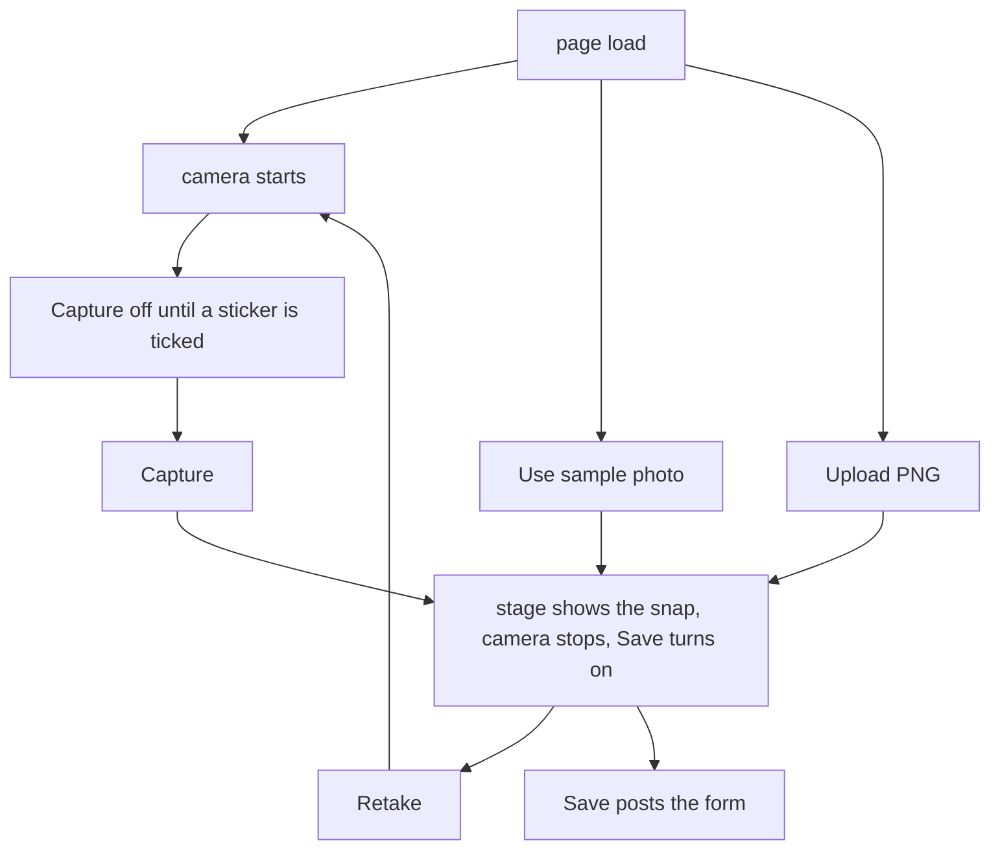

# 13 Editor page

The browser page [public/editor.html](../../public/editor.html). `editor_page` in [app/pages.py](../../app/pages.py) fills its `{{csrf}}`, `{{message}}`, and `{{thumbs}}` markers. The server blend is [12-compose.md](12-compose.md), and the editor walkthrough is [01-editor.md](../01-editor.md).

The sticker on the live camera and Save GIF are covered in [23-preview.md](23-preview.md). This page sends the photo and the sticker names, and the server draws the saved still.

## What a click changes



Clicking Use sample photo sets the hidden field `use_sample` to `1` and empties `upload_b64`, then stops the camera and shows `/base.png` on the stage. Save turns on, and Capture now reads Retake.

There are three ways to get a photo but only two fields. A snap and an upload both fill `upload_b64`, because both are bytes from the browser. The sample is different: the browser does not send the file, it sends `use_sample=1`, and the server reads `public/base.png` itself.

The sample photo and the two stickers are drawings made for this repo, added in commit `cc1fd86` on 24 Oct 2026, so the files carry no credit.

## The two gates

```javascript
function updateButtons() {
  var capture = byId("capture");
  // True when the frozen photo is on screen, not the live camera.
  var still = !byId("preview").hidden;

  capture.textContent = still ? "Retake" : "Capture";
  capture.disabled = still ? false : !(stream && hasSticker());
  byId("save").disabled = !hasBase();
  byId("gif-save").disabled = !(!still && stream && hasSticker());
}
```

Printed page 8 says the capture button stays inactive until a superposable image is selected. `hasSticker` is that check, and the camera has to be running too. Once the frozen photo is showing, Capture becomes Retake and stays clickable.

Save stays off until `hasBase`, meaning a captured snap, an upload, or the sample, and the hint under the buttons says the same. The last line is the Save GIF gate from [23-preview.md](23-preview.md).

## The snap

```javascript
function captureOrRetake() {
  var video = byId("camera");
  var url;

  // Retake. A snap is already showing, so clear it and open the camera again.
  if (!byId("preview").hidden) {
    clearStill();
    startCamera();
    return;
  }

  // Capture. Copy one camera frame into the hidden canvas and show that picture.
  if (!stream || !hasSticker()) {
    return;
  }

  url = pngDataUrl(video);
  byId("upload-b64").value = url.slice(url.indexOf(",") + 1);
  byId("use-sample").value = "";
  showStill(url);
}
```

The first branch is Retake and the second is Capture, as the comments in the function say.

`pngDataUrl` draws onto the hidden `canvas`, because `getContext("2d")` can copy one video frame with `drawImage`, and `toDataURL` can turn that copy into a PNG; a video tag can do neither. The visible picture is the `img`, and the comment above `toDataURL` links the documentation.

The form posts the text in `upload_b64`. `showStill` stops the camera, so the camera light goes off.

## Upload and the sample

`readUpload` receives the file control because the markup says `onchange="readUpload(this)"`. Inside an inline handler `this` is the input, but inside the function it would not be, so the markup passes it in.

An upload goes through `FileReader`, which turns the chosen file into the same kind of text as a snap. When the file's type starts with `image/`, that text also becomes the stage image. A file with any other type still fills `upload_b64`, and Save still posts it. Printed page 6 rules out unwanted uploads without spelling out how; AC-10 says nothing is stored. The server checks the bytes and the page says the file is not an image, so the refusal is visible.

## The camera

`startCamera` runs as the page loads and calls `getUserMedia`, the browser function that asks for the camera. The subject does not name that function, but printed page 5 forbids console logs, and the one tolerated exception is a `getUserMedia` warning when the page is not HTTPS. That warning comes from this call. It is the browser saying the camera is blocked because the page is not a secure origin, with text along the lines of `getUserMedia` no longer working on an insecure origin and the site needing HTTPS. [Secure contexts](https://developer.mozilla.org/en-US/docs/Web/Security/Secure_Contexts)

`http://localhost` and `http://127.0.0.1` count as secure, so Chrome stays quiet there, which is why a run on `make up` shows no warning. It appears on plain HTTP to a real host name or a LAN address, such as `http://192.168.1.10:8080`. Any other console error from this code is not allowed.

There is no `try`, because the failure is a rejected promise, not a throw. `.then(cameraReady, function () {})` passes two functions: the browser calls the first with the stream when the camera is allowed and the second with the error when it is not. The second function is empty, so a refusal does not become an unhandled error in the console, and the prefixed `getUserMedia` fallback does the same with its error callback. After a refusal the stage keeps its empty-state sentence and Capture stays off, while upload and the sample still work.

Our code never calls `cameraReady` itself; it hands the function to `getUserMedia`, and when the user allows the camera, the browser calls `cameraReady(stream)`, so the `media` parameter is that stream. `byId("camera")` is the video tag, and setting `video.srcObject` to the stream, or `video.src` on Chrome 46, connects the two. The tag then plays it because of `autoplay`.

`stopCamera` walks `stream.getTracks()`. The call asks for video only, so there is one track, and that track is what keeps the camera light on. Dropping the variable is not enough; the track itself has to be stopped, and the comment on that line says so.

The camera prompt does not freeze the page, so Use sample photo can be clicked while the browser is still asking. The sample is then already on screen when the browser hands over the camera, and `cameraReady` sees that photo and hangs up, so the light stays off. `stream = media` comes before that check because `stopCamera` reads `stream`.

The browser floor for the whole site is [01-accounts.md](../01-accounts.md#7-old-browsers).
