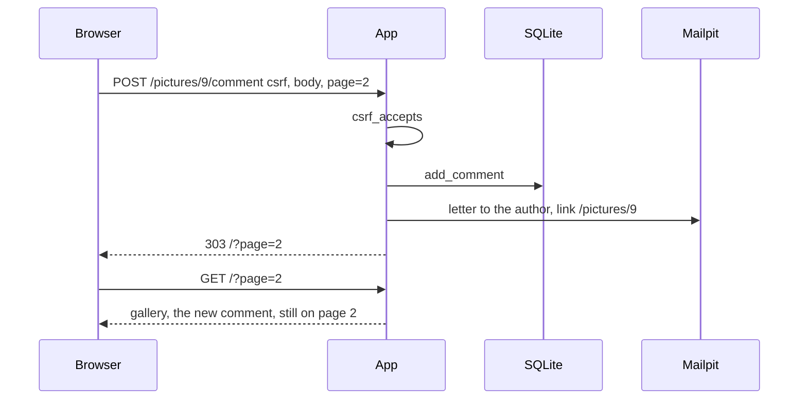

# 17 Gallery routes

The gallery handlers in [app/server.py](../../app/server.py): `_gallery`, the like and comment branches of `_picture`, `_like`, `_comment`, and `_gallery_address`. The gallery walkthrough is [gallery.md](../gallery.md). The cards are drawn in [18-gallery-page.md](18-gallery-page.md), the query that orders the rows is [19-gallery-query.md](19-gallery-query.md), and delete and the image address are in [11-editor-routes.md](11-editor-routes.md).

## One comment, end to end



The browser posts the text, not the finished page. The `303` leaves a GET in the address bar, which is why a refresh does not ask to resubmit. When the page script is running, the same post also carries `xhr=1` and gets JSON back instead of the redirect; that path is [24-reply.md](24-reply.md#json-instead-of-a-redirect).

## Opening the gallery

Anything that is not a named route falls through to the gallery, so `/` and `/?page=2` both end here.

```python
        if path.startswith("/pictures/"):
            return _picture(conn, secret, method, form, user, path)

        return _gallery(conn, user, gallery_query(query))
```

For a logged-out visitor `user` is `None`, and the page still renders, because printed page 7 says the gallery is public. Like and comment are refused later, on the POST.

```python
def _gallery(
    conn: sqlite3.Connection,
    user: SessionUser | None,
    query: GalleryQuery,
) -> Response:
    raw_page = query["page"] or "1"
    notice = _notice(query["notice"])
    page_number = int(raw_page) if raw_page.isdigit() and int(raw_page) > 0 else 1
    size = 5
    total = picture_count(conn)
    last = 1 if total == 0 else (total + size - 1) // size

    if page_number > last:
        code = query["notice"] if notice else ""

        return _redirect(_gallery_address(str(last), code, query["fragment"] == "1"))

    rows: list[GalleryCard] = []

    for row in gallery_rows(conn, page_number, size):
        rows.append(
            gallery_card(
                row,
                comments_for(conn, row["id"]),
                _base() + "/pictures/" + str(row["id"]),
            )
        )

    has_next = page_number * size < total

    return _html(
        gallery_page(
            user,
            rows,
            page_number,
            has_next,
            notice,
            query["fragment"] == "1",
        )
    )
```

`page` comes from the query string, and when it appears twice the last value wins. `page=2` is page 2, while `page=0`, `page=foo`, and a missing page all fall back to page 1.

`size` is 5, because printed page 7 asks for at least 5 per page.

`last` is the last page that has pictures. `//` is integer division, which drops the remainder, so `(total + size - 1) // size` rounds up to the number of pages of 5 the pictures fill. Six pictures give `(6 + 5 - 1) // 5`, which is `10 // 5`, or 2; five give `(5 + 4) // 5`, or 1; eleven give `(11 + 4) // 5`, or 3. Zero pictures would come out as page 0, so that case is pinned to page 1.

With six pictures, page 1 asks for offset 0 and gets five of them, and since `5 < 6` is true, `has_next` is true and the page draws Next. Page 2 asks for offset 5 and gets the one older picture, and `10 < 6` is false, so there is no Next. `gallery_page` draws Previous whenever the number is above 1.

`/?page=23` is past that last page. Rather than render an empty gallery with a Previous link to page 22, the handler returns `303 /?page=2`, and with no pictures at all, where the last page is 1, it returns `303 /`. A real `notice=nomail` survives that redirect, while an unknown notice code is dropped. A `fragment=1` request past the end becomes `303 /?page=2&fragment=1`, because the page script's next-page request follows the redirect and must still get bare cards rather than a whole page nested inside the gallery.

The loop runs two kinds of query: `gallery_rows` loads the page, at most five rows, and `comments_for` then runs once per row. After the count, five pictures cost six queries, the classic N+1 shape of one list query plus one more per item. Printed page 7 does not require a single query, and five rows is the whole page, so the app leaves it that way.

The third argument to `gallery_card` is the full picture address that the share links carry ([25-share.md](25-share.md)). `fragment=1` is the infinite-scroll request, which asks `gallery_page` for the next cards without the shell ([24-reply.md](24-reply.md#the-next-page)).

`_notice("nomail")` is the sentence "the mail was not sent". A code that is not in the map gives an empty string, so a typed address cannot inject text. The same map holds the account and editor sentences.

`parse_qs` reads the raw query string inside `parsed_query`, and that dict stays in `handle`. The gallery gets `gallery_query` instead, which copies only `page`, `notice`, and `fragment`, so `/?page=2&username=ada` hands `_gallery` the object `{"page": "2", "notice": "", "fragment": ""}`. `username` is a field the login handler uses, and since it is not a key on this object, this function cannot read it or pass it on. Posted forms follow the same rule: `_like` receives `csrf`, `page`, and `xhr`, and `_comment` receives `csrf`, `body`, `page`, and `xhr`.

When a comment's mail fails, the redirect puts `notice=nomail` on the address, and this GET turns that code into the sentence.

## Like and comment enter through the picture path

```python
def _picture(
    conn: sqlite3.Connection,
    secret: str,
    method: str,
    form: Parsed,
    user: SessionUser | None,
    path: str,
) -> Response:
    rest = path[len("/pictures/") :]

    if rest.endswith("/like") and method == "POST":
        return _like(conn, user, like_form(form), secret, rest[: -len("/like")])

    if rest.endswith("/comment") and method == "POST":
        return _comment(conn, user, comment_form(form), secret, rest[: -len("/comment")])
```

`/pictures/9/like` leaves `rest` as `9/like`, and cutting the suffix leaves `9`. A GET of that address does not match, so it falls through to the delete and image checks in [11-editor-routes.md](11-editor-routes.md), where a non-digit ends at the editor redirect.

## One like, and it stays on the page

```python
def _like(
    conn: sqlite3.Connection,
    user: SessionUser | None,
    form: LikeForm,
    secret: str,
    picture_id: str,
) -> Response:
    author = None

    if user is not None and _member_ok(user, form["csrf"], secret) and picture_id.isdigit():
        author = picture_author(conn, int(picture_id))

    if author is not None and user is not None:
        like_once(conn, user["id"], int(picture_id))

    if form["xhr"] == "1":
        count = like_count(conn, int(picture_id)) if picture_id.isdigit() else 0

        return _json({"likes": count})

    return _redirect(_gallery_address(form["page"], ""))
```

`POST /pictures/9/like` from a logged-in member, with a valid CSRF token and the hidden `page` of `2`, stores one like for that member and that picture, then returns `303 /?page=2`. Posting the same pair again stores nothing, because `like_once` is `insert or ignore` on `(user_id, picture_id)`, so the count stays `1 like`. With `xhr=1` the reply is the new count as JSON instead of the redirect.

A logged-out post has `user` of `None`, so `_member_ok` is false, `author` stays `None`, and nothing is inserted. The redirect still uses the posted page, which returns the browser to `/?page=2` with the count unchanged. Printed page 7 allows a like only for a connected user, and although the page omits the button for visitors, this check is what refuses a forged post.

A bad CSRF token takes the same path as a logged-out post: no row, then the redirect.

## The comment and the letter

```python
def _comment(
    conn: sqlite3.Connection,
    user: SessionUser | None,
    form: CommentForm,
    secret: str,
    picture_id: str,
) -> Response:
    notice = ""
    stored = False

    if user is not None and _member_ok(user, form["csrf"], secret) and picture_id.isdigit():
        author = picture_author(conn, int(picture_id))
        body = form["body"]

        if author is not None and body:
            add_comment(conn, int(picture_id), user["id"], body)
            stored = True
            mail = comment_mail(
                author["username"],
                author["email"],
                _base() + "/pictures/" + picture_id,
                user["username"],
                bool(author["mail_ok"]),
            )

            if mail is not None and not _send(author["email"], mail):
                notice = "nomail"

    if form["xhr"] == "1":
        return _json({
            "ok": stored,
            "body": form["body"],
            "username": user["username"] if user else "",
            "notice": _notice(notice),
        })

    return _redirect(_gallery_address(form["page"], notice))
```

`POST /pictures/9/comment` with `body=hello` and `page=2` stores the row, mails the author, and returns `303 /?page=2`. A reload is a GET, so it does not post the body again and the comment stays one line. An empty body stores nothing and sends nothing, but the redirect still happens.

`comment` in [app/mail.py](../../app/mail.py) is imported as `comment_mail`. It returns a letter when `mail_ok` is on and `None` when the author turned notification off, and the test `if mail is not None and not _send(...)` relies on that: a letter passes the first check, so `_send` runs, while `None` fails it, so `_send` is skipped. The comment is on the page either way. That is the preference on printed page 7: no mail goes out when the preference is false.

`_send` returns false when Mailpit is down. The comment is already stored by then, so the redirect becomes `/?page=2&notice=nomail` and the page says the mail was not sent.

The link in the letter is `_base()` plus `/pictures/9`, which under `make up` is `http://localhost:8080/pictures/9`, the stored image. There is no address for a single comment. Printed page 7 does not require a link; the letter has one because every letter in this app does, as noted in [gallery.md](../gallery.md#notes).

The author is mailed for their own comment too, because the same code runs and it never compares the commenter with the author. That reading is also in [gallery.md](../gallery.md#notes).

## The address the redirect uses

```python
def _gallery_address(page: str, notice: str, fragment: bool = False) -> str:
    parts: list[str] = []

    if page.isdigit() and int(page) > 1:
        parts.append("page=" + page)

    if notice:
        parts.append("notice=" + notice)

    if fragment:
        parts.append("fragment=1")

    return "/?" + "&".join(parts) if parts else "/"
```

Page `1` and a missing page return `/`, and page `2` returns `/?page=2`. A notice is added only after a failed send, and a like never sets one, so a like on page 2 returns to `/?page=2` and a like on page 1 returns to `/`.

`fragment` defaults to false, so the like and comment redirects never carry it. Only the past-the-end redirect in `_gallery` passes it, which turns page 2 into `/?page=2&fragment=1` and page 1 into `/?fragment=1`.

```python
def _member_ok(user: SessionUser | None, csrf: str, secret: str) -> bool:
    if user is None:
        return False

    return csrf_accepts(csrf, user["id"], user["session_version"], secret)
```

This is the same token as the profile form ([03-session.md](03-session.md)). A form on another site cannot know it, so it cannot like or comment as that member. What gets checked is the `csrf` field from the handler's allow-list, not the whole post.
